# PRD — Sistem Kolekte (PWA Kolekte + Back Office)

| Item | Isi |
|---|---|
| Versi | 0.4 — pecahan, lingkungan, dan jenis kantong jadi konstanta; kategori kantong dihapus; Parkir dan Intensi wajib |
| Tanggal | 8 November 2026 |
| Penyusun | Vincent (System Analyst) |
| Status | Draft — menunggu konfirmasi Open Questions (Bagian 13) |
| Dokumen terkait | [Technical_Logic_Sistem_Kolekte.md](Technical_Logic_Sistem_Kolekte.md) |

**Perubahan dari v0.3:** pembuat dan pereview **boleh orang yang sama** (aturan "nama berbeda" dihapus); tiap petugas memilih satu kantong untuk diisi. pecahan (11), lingkungan (7), dan jenis kantong (Merah, Kuning, Parkir, Intensi) **bukan master data** lagi (konstanta di aplikasi). **Kategori kantong dihapus**: dari kantong langsung ke pecahan × qty. **Parkir dan Intensi wajib** diisi di setiap sesi (nilai 0 dicatat sebagai "Kosong"). Tanpa PIN untuk PWA. Pemberitahuan edit pereview hanya terlihat di Back Office. Satu-satunya master data adalah **Misa**.

**Perubahan dari v0.2 (jadi v0.3):** Misa jadi master data (+ Jumat Pertama pilih bulan 1–12); field "Perayaan" dan tombol Tolak dihapus; review per misa dengan checklist dan Edit dulu.

---

## 1. 🎯 Executive Summary

Sistem Kolekte mendigitalkan pencatatan hasil kolekte per misa. Petugas Kolekte memakai **PWA** (tanpa login): mengetik nama, memilih tanggal, misa, dan lingkungan, lalu memilih **satu kantong** untuk diisi hasil hitung uangnya, dari **Kantong Merah**, **Kantong Kuning**, **Parkir**, dan **Intensi** per pecahan. Setiap bagian di-**Submit**. Orang kedua (pereview) memilih misa hari itu, mengetik namanya, melihat daftar detail semua bagian dari semua lingkungan, mencentang semuanya, lalu **Approve** (atau mengedit isian dulu baru Approve). Setelah keempat bagian sebuah lingkungan disetujui, **Admin Keuangan di Back Office** memeriksa total dan menutup sesi.

Nilai utama: angka tercatat per pecahan (bisa diaudit), setiap bagian punya catatan pembuat dan pereview, rekap total otomatis, tanpa rekap manual di kertas.

---

## 2. 🧭 Asumsi & Scope

### 2.1 Asumsi

| # | Asumsi |
|---|---|
| A1 | Konteks: kolekte misa paroki. **7 lingkungan/wilayah** tetap (Bagian 2.5), tidak akan bertambah, disimpan sebagai konstanta (bukan master data). |
| A2 | **Misa** adalah master data: *Sabtu Sore*, *Minggu 1*, *Minggu 2*, dan *Jumat Pertama*. Untuk misa bertanda "minta bulan" (Jumat Pertama), pembuat wajib memilih **bulan 1–12**. |
| A3 | **Sesi Kolekte** = satu lingkungan × satu tanggal × satu misa. Konteks diisi di awal: nama pembuat, tanggal, misa (+ bulan), lingkungan. Semua data kantong menempel pada sesi ini. Tidak ada lagi isian "Minggu ke / Perayaan". |
| A4 | Tidak ada kategori kantong. Tiap kantong (Merah, Kuning, Parkir, Intensi) langsung diisi per **pecahan × qty**. Keempat jenis kantong adalah konstanta. |
| A5 | **PWA tanpa login.** Nama Pembuat dan Nama Pereview **diketik manual** dan disimpan sebagai teks. Hanya Back Office yang memakai login. |
| A6 | Tiap petugas memilih **satu kantong** untuk diisi, sehingga ada **4 isian per misa per lingkungan** (Merah, Kuning, Parkir, Intensi). Setiap bagian punya dua peran: **pembuat** dan **pereview**. **Pembuat dan pereview boleh orang yang sama.** Review dilakukan lewat PWA **per misa** untuk semua lingkungan sekaligus. |
| A7 | Pereview boleh **mengedit isian** (pecahan/qty) sebelum approve. Perubahan dicatat (siapa, subtotal sebelum → sesudah). Tidak ada Tolak; koreksi dilakukan lewat Edit. |
| A8 | **Keempat bagian wajib** di setiap sesi, termasuk Parkir dan Intensi. Bila nilainya 0, bagian tetap disubmit dengan tanda **"Kosong"** dan tetap harus disetujui. |
| A9 | Back Office: **Admin** dan **Admin Keuangan**. Keduanya mengelola master data. Hanya **Admin Keuangan** yang menyetujui/mengembalikan sesi (review total). |
| A10 | Pecahan uang: 11 pecahan tetap (Bagian 2.6), konstanta. Rp1.000 hanya satu baris (kertas dan koin dijumlahkan). |
| A11 | Akun Back Office dibuat di Supabase Auth dan didaftarkan ke tabel `bo_user` (belum ada layar kelola pengguna). |

### 2.2 In-scope
- PWA (tanpa login): journey pembuat dan journey pereview.
- Back Office: login, daftar sesi, detail + rekap per pecahan, approve/return sesi, **master data Misa**.
- Total otomatis, status workflow, jejak review.

### 2.3 Out-of-scope (fase ini)
- Pembayaran/transfer bank otomatis, integrasi akuntansi/ERP.
- Alat penghitung uang, donasi online.

### 2.4 Aktor

| Aktor | Peran | Platform |
|---|---|---|
| Petugas Kolekte (Pembuat) | Mengisi dan men-submit bagian; mengetik nama sendiri | PWA (tanpa login) |
| Pereview (boleh orang yang sama dengan pembuat) | Memilih misa hari itu, mengetik nama, memeriksa daftar, mengedit bila perlu, mencentang dan approve | PWA (tanpa login) |
| Admin | Kelola master data Misa | Web BO (login) |
| Admin Keuangan | Kelola master data Misa, **review total dan finalisasi sesi** | Web BO (login) |

### 2.5 Lingkungan / Wilayah (7, konstanta)

1. Sta. Felisitas
2. St. Edmund
3. St. Hieronimus
4. St. Fransiscus Xaverius
5. Sta. Veronica
6. Sta. Maria Ratu Rosari
7. Sta. Maria Medali Wasiat

Tidak ada layar kelola. Mengubah daftar ini berarti mengubah kode dan migrasi database.

### 2.6 Pecahan Uang (11, konstanta)

| Urut | Nilai (Rp) | Tipe |
|---|---|---|
| 1 | 100.000 | Kertas |
| 2 | 75.000 | Kertas (peringatan) |
| 3 | 50.000 | Kertas |
| 4 | 20.000 | Kertas |
| 5 | 10.000 | Kertas |
| 6 | 5.000 | Kertas |
| 7 | 2.000 | Kertas |
| 8 | 1.000 | Kertas/Koin (satu baris) |
| 9 | 500 | Koin |
| 10 | 200 | Koin |
| 11 | 100 | Koin |

### 2.7 Master Data Misa (satu-satunya master data)

| Urut | Nama | Minta bulan |
|---|---|---|
| 1 | Sabtu Sore | Tidak |
| 2 | Minggu 1 | Tidak |
| 3 | Minggu 2 | Tidak |
| 4 | Jumat Pertama | **Ya** (pilih 1–12) |

Dikelola Admin dan Admin Keuangan di Back Office. Tidak dihapus, hanya dinonaktifkan.

---

## 3. 🗺️ Mindmap Aplikasi

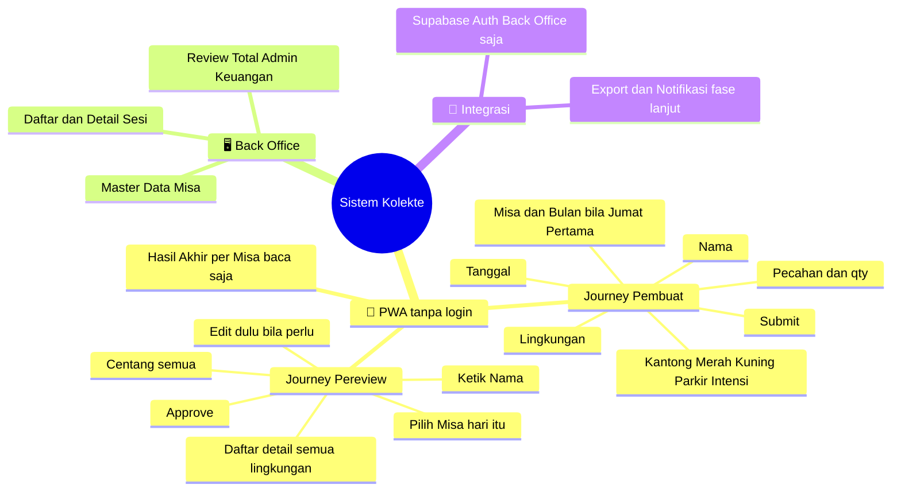

---

## 4. 🔄 General Flow Process

### 4.1 Journey Pembuat (PWA)

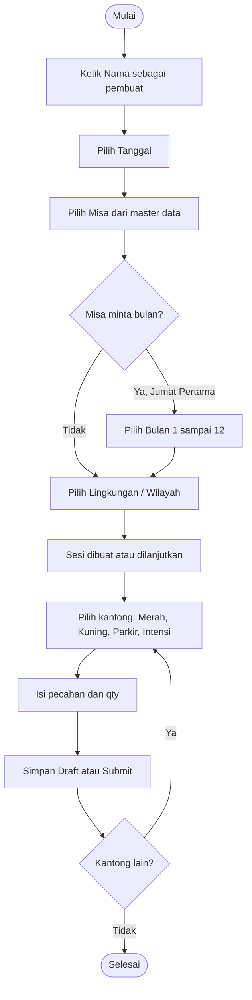

### 4.2 Journey Pereview (PWA)

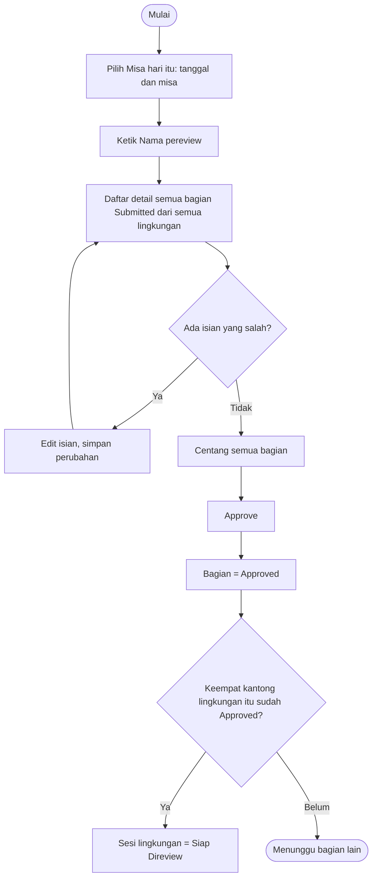

### 4.3 Review Total (Back Office)

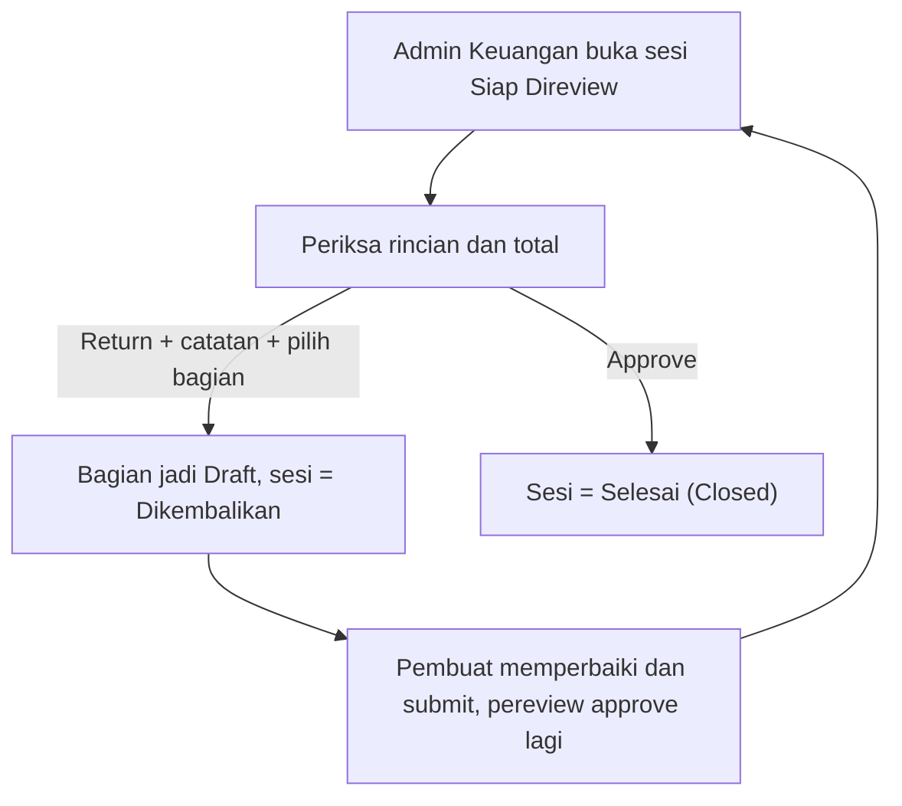

**Aturan kunci**
1. Setiap bagian wajib diisi minimal satu baris qty > 0, atau ditandai "Kosong", sebelum Submit.
2. Sesi **Siap Direview** hanya jika keempat bagian (Merah, Kuning, Parkir, Intensi) sudah **Approved**. Parkir dan Intensi wajib; bila nilainya 0, submit dengan tanda "Kosong".
3. Pembuat dan pereview boleh orang yang sama; nama keduanya tetap wajib diketik dan dicatat.
4. Approve bersifat sekaligus: semua bagian yang dicentang disetujui bersama, atau tidak sama sekali.
5. Tombol Approve baru aktif setelah semua bagian yang dapat disetujui pereview dicentang.

---

## 5. 🔁 State Machine

### 5.1 Status Bagian

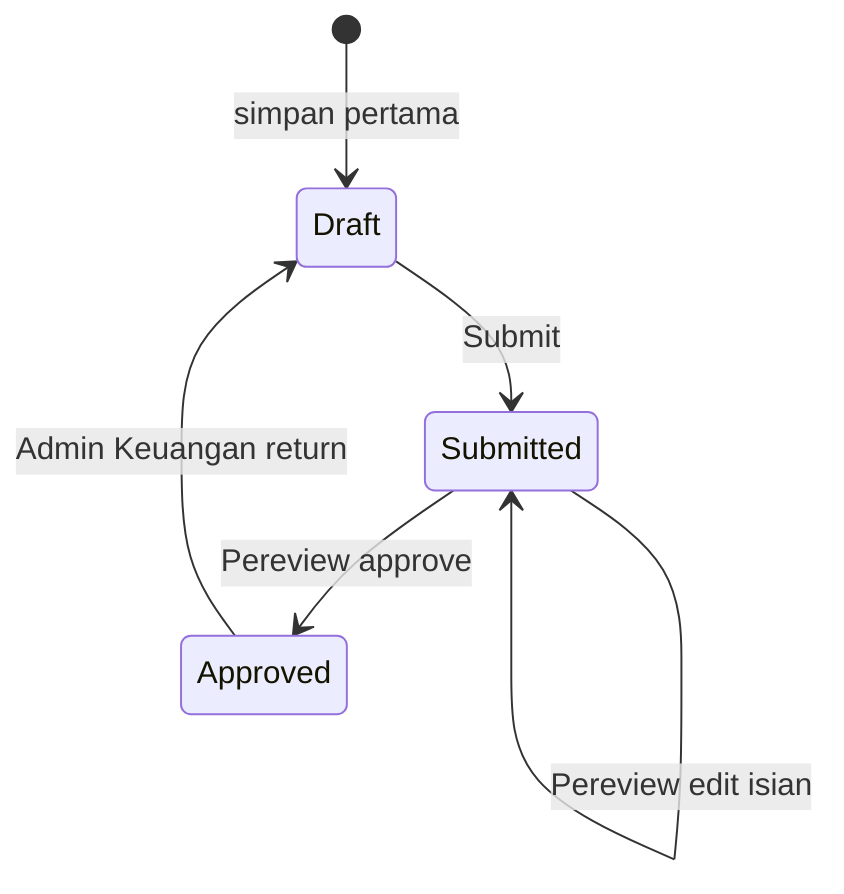

### 5.2 Status Sesi

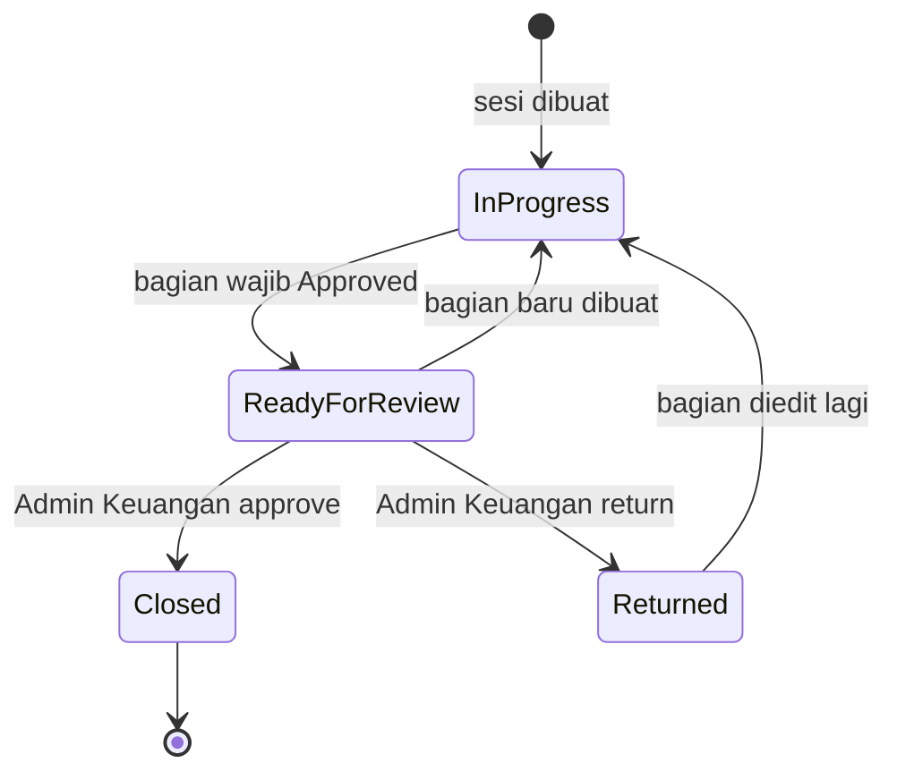

---

## 6. 📝 Business Requirements

### 6.1 Functional Requirements — PWA

| ID | Requirement | Prioritas |
|---|---|---|
| FR-PWA-01 | PWA tanpa login. **Nama** diketik manual (wajib, 2–60 karakter), diingat di perangkat. Nama pembuat tersimpan per bagian; nama pereview tersimpan per tindakan review. | High |
| FR-PWA-02 | Urutan isian pembuat: **Nama → Tanggal → Misa (master data) → Bulan (hanya bila misa meminta, 1–12) → Lingkungan/Wilayah (7 pilihan tetap)**. | High |
| FR-PWA-03 | Satu lingkungan hanya punya satu sesi per kombinasi tanggal + misa; membuka lagi = melanjutkan sesi yang ada. | High |
| FR-PWA-04 | Halaman sesi menampilkan kartu Kantong Merah, Kuning, Parkir, Intensi beserta status dan subtotal. Keempatnya wajib. | High |
| FR-PWA-05 | Setiap kantong diisi langsung per **pecahan × qty** (11 pecahan tetap); subtotal dan total dihitung otomatis. Tidak ada kategori. | High |
| FR-PWA-06 | Parkir dan Intensi diisi dengan pola yang sama dan **wajib**; nilai 0 dicatat dengan tanda "Kosong". | High |
| FR-PWA-07 | Validasi: qty bilangan bulat 0–1.000.000, pecahan salah satu dari 11 pecahan tetap, tidak ada baris ganda. Bagian tidak bisa disubmit kosong kecuali ditandai "Kosong". | High |
| FR-PWA-08 | Submit mengunci isian pembuat (status Submitted). | High |
| FR-PWA-09 | **Review per misa:** pereview memilih tanggal + misa, mengetik namanya, lalu melihat daftar detail semua bagian Submitted dari semua lingkungan pada misa itu. | High |
| FR-PWA-10 | Setiap bagian punya kotak centang. **Approve** baru aktif setelah semua bagian dalam daftar dicentang (tersedia tombol "Centang semua"). | High |
| FR-PWA-11 | Pereview dapat **Edit dulu** (ubah pecahan/qty) pada bagian Submitted, lalu kembali ke daftar dan approve. Edit dicatat (nama pereview, subtotal sebelum → sesudah). | High |
| FR-PWA-12 | Approve memproses semua bagian yang dicentang secara atomik. Pereview boleh sama dengan pembuat. | High |
| FR-PWA-13 | Sesi otomatis **Siap Direview** saat keempat bagian Approved (Aturan kunci #2). | High |
| FR-PWA-14 | Draft tersimpan lokal (offline) dan tersinkron saat online. **Belum dibangun.** | Medium |
| FR-PWA-16 | **Hasil akhir per misa (baca saja):** pilih tanggal + misa, lihat total per lingkungan dan per kantong, total semua lingkungan, status tiap lingkungan, dan rekap per pecahan. Tidak bisa menutup/finalisasi; finalisasi tetap oleh Admin Keuangan di Back Office. | High |
| FR-PWA-15 | Dapat di-install ke home screen (manifest; service worker belum). | Medium |

### 6.2 Functional Requirements — Back Office

| ID | Requirement | Prioritas |
|---|---|---|
| FR-BO-01 | Login (hanya Back Office): Admin dan Admin Keuangan; RBAC. | High |
| FR-BO-02 | Daftar sesi (tanggal, lingkungan, misa+bulan, status, total); antrean Siap Direview di atas. | High |
| FR-BO-03 | Detail sesi: rincian tiap bagian per pecahan, subtotal, **total keseluruhan**, **rekap lembar per pecahan**, nama pembuat/pereview, dan tanda "Diedit oleh …" bila pereview mengubah isian (satu-satunya tempat edit pereview terlihat; pembuat tidak diberi notifikasi). | High |
| FR-BO-04 | Admin Keuangan **Approve** (sesi Closed) atau **Return** dengan catatan dan memilih bagian yang dibuka ulang. Admin biasa hanya melihat. | High |
| FR-BO-05 | Review total tidak mengubah angka; hanya approve atau return. | High |
| FR-BO-06 | **Master data Misa** oleh Admin dan Admin Keuangan: tambah, ubah (nama, minta bulan, urutan), aktif/nonaktif. Tidak ada hapus. Pecahan, lingkungan, dan jenis kantong bukan master data. | High |
| FR-BO-07 | Laporan rekap dan export Excel/PDF. **Belum dibangun.** | Medium |
| FR-BO-08 | Audit log umum. **Belum dibangun**; saat ini jejak review tersimpan di `section_review` (APPROVE, EDIT) dan `session_review` (APPROVE, RETURN). | Medium |
| FR-BO-09 | Sesi Closed read-only. | High |
| FR-BO-10 | Layar kelola pengguna Back Office. **Belum dibangun**; dibuat lewat Supabase Auth dan tabel `bo_user`. | Low |

### 6.3 Non-Functional Requirements

| ID | Kategori | Requirement |
|---|---|---|
| NFR-01 | Performa | Respons halaman input < 2 detik pada 4G; subtotal dihitung instan di klien. |
| NFR-02 | Ketersediaan | 99,5% pada jam misa. |
| NFR-03 | Keamanan | HTTPS, RBAC, validasi server-side, tabel hanya diakses lewat server (service role), fungsi database tidak dapat dipanggil dari browser. |
| NFR-04 | Integritas data | Uang disimpan integer (rupiah); total dihitung ulang server; nilai pecahan disimpan sebagai snapshot di baris. |
| NFR-05 | Auditability | Perubahan status dan edit pereview tercatat; riwayat review tidak dapat dihapus lewat aplikasi. |
| NFR-06 | Usability | Mobile-first, input numerik, bahasa Indonesia. |
| NFR-07 | Offline | Draft bertahan saat koneksi putus (**rencana**). |
| NFR-08 | Kompatibilitas | Android Chrome dan iOS Safari terbaru. |

---

## 7. 👥 Use Case

| ID | Use Case | Aktor | Deskripsi | Prioritas |
|---|---|---|---|---|
| UC-01 | Login Back Office | Admin, Admin Keuangan | Autentikasi | High |
| UC-02 | Mulai Sesi | Pembuat | Nama, tanggal, misa (+bulan), lingkungan | High |
| UC-03 | Isi dan Submit Bagian | Pembuat | Pilih kantong, isi pecahan × qty, submit | High |
| UC-04 | Review Misa | Pereview | Pilih misa hari itu, ketik nama, lihat daftar, centang semua, approve | High |
| UC-05 | Edit Sebelum Approve | Pereview | Ubah isian bagian Submitted | High |
| UC-06 | Review Total Sesi | Admin Keuangan | Approve (Closed) atau Return | High |
| UC-08 | Lihat Hasil Akhir | Siapa pun di PWA | Rekap per misa (baca saja) | High |
| UC-07 | Kelola Master Misa | Admin, Admin Keuangan | Tambah/ubah/nonaktifkan misa | High |

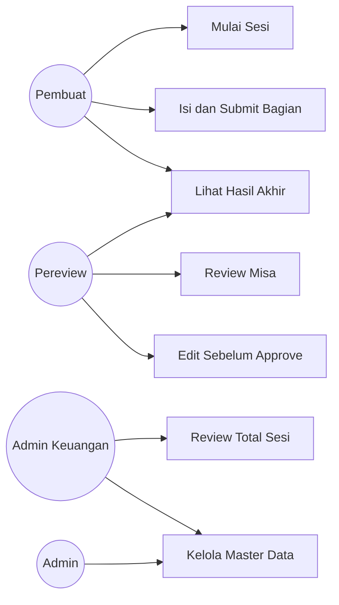

---

## 8. 🔀 Sequence Diagram

### 8.1 Pembuat: Submit Bagian

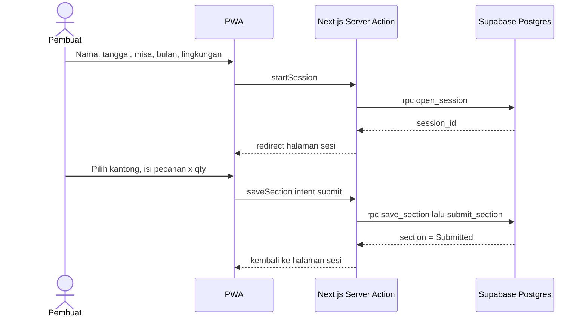

### 8.2 Pereview: Edit lalu Approve

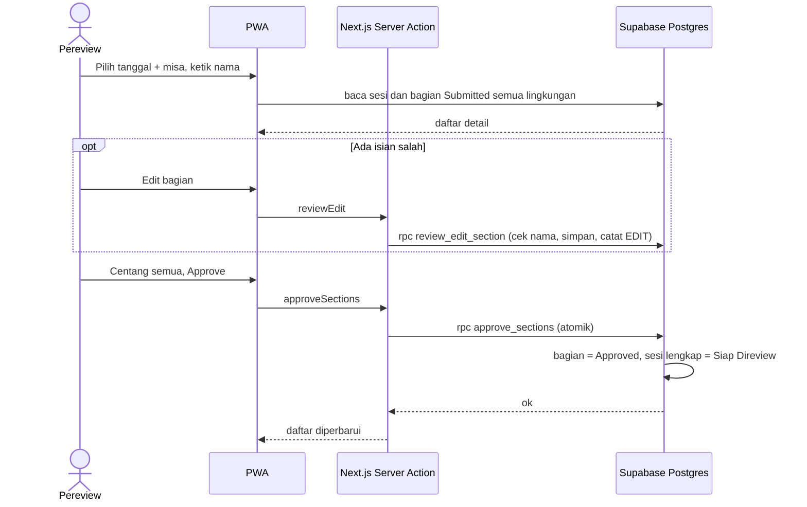

### 8.3 Review Total

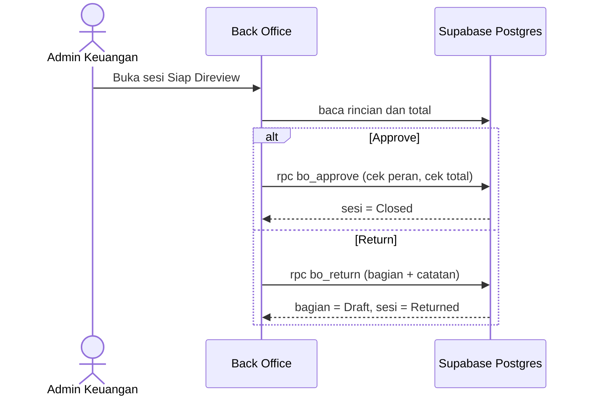

---

## 9. 🗄️ ERD / Data Model

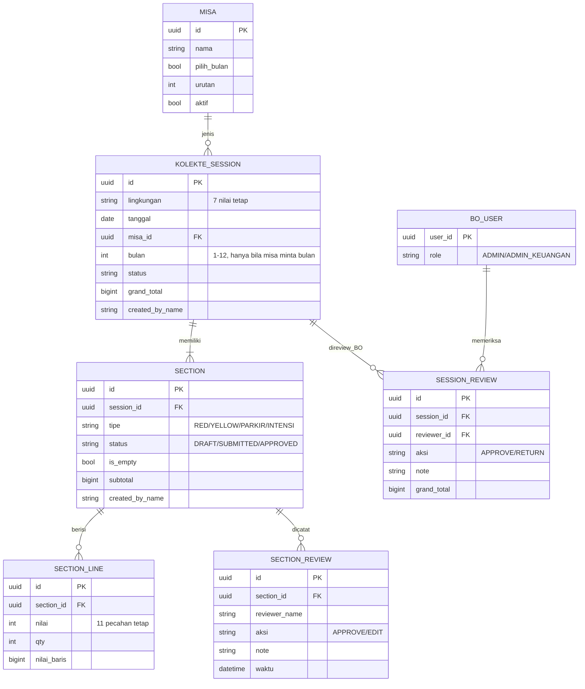

**Catatan data**
- Unik: `(lingkungan, tanggal, misa_id)` pada sesi; `(session_id, tipe)` pada bagian; `(section_id, nilai)` pada baris.
- `lingkungan` dan `nilai` dibatasi ke nilai tetap lewat constraint database (fungsi `valid_lingkungan` dan `valid_nilai`).
- `nilai_baris = nilai × qty` disimpan di baris sehingga rekap tidak perlu menghitung ulang.
- `bulan` hanya terisi bila misa bertanda `pilih_bulan`.

---

## 10. 🧩 Component Architecture

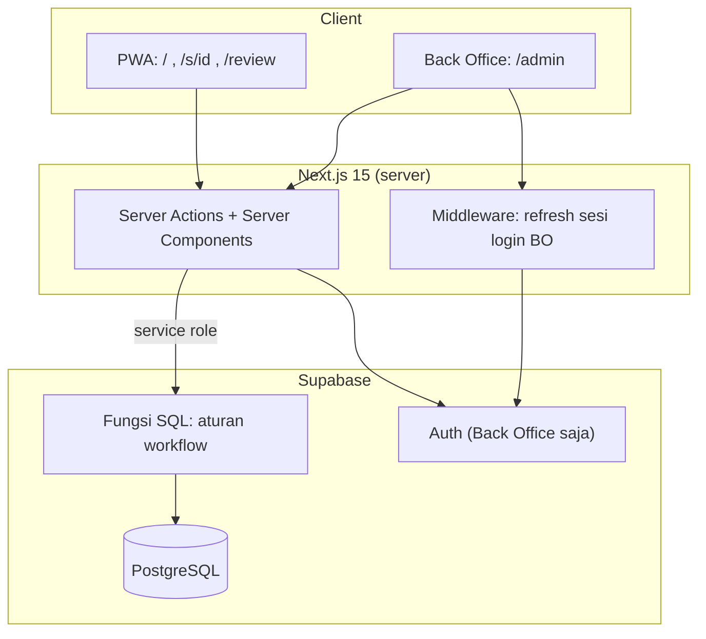

---

## 11. 🔌 Integration Map

| Kategori | Kebutuhan | Rekomendasi | Fase |
|---|---|---|---|
| Auth | Login Back Office (PWA tanpa login) | Supabase Auth | 1 (selesai) |
| Export | Rekap Excel/PDF | Library server-side | 2 |
| Notifikasi | Ingatkan Admin Keuangan saat Siap Direview | Email / WhatsApp | 2 |
| Monitoring | Error tracking | Sentry | 2 |
| ERP/Payment | Tidak diperlukan | — | Out of scope |

---

## 12. 🏗️ Technical Stack

| Layer | Pilihan |
|---|---|
| Frontend + server | Next.js 15 (App Router, Server Actions), React 19, TypeScript |
| Database + Auth | Supabase (PostgreSQL, Auth). Aturan workflow di fungsi SQL (atomik), akses tabel hanya via service role |
| Hosting | Vercel + Supabase |

### 12.1 Permukaan Aplikasi

| Alamat | Fungsi |
|---|---|
| `/` | Journey pembuat: mulai sesi |
| `/s/{id}`, `/s/{id}/{tipe}` | Kartu kantong dan formulir pecahan |
| `/review` | Journey pereview: pilih misa, nama, daftar, centang, approve |
| `/review/edit/{sectionId}` | Pereview mengedit bagian |
| `/hasil` | Hasil akhir per misa (baca saja) |
| `/admin`, `/admin/{id}` | Daftar dan detail sesi, review total |
| `/admin/master/misa` | Master data Misa |

### 12.2 Hak Akses

| Fitur | Pembuat (PWA) | Pereview (PWA) | Admin | Admin Keuangan |
|---|---|---|---|---|
| Isi dan submit bagian | ✅ | — | ❌ | ❌ |
| Review misa (centang, edit, approve) | ❌ | ✅ | ❌ | ❌ |
| Review total (approve/return sesi) | ❌ | ❌ | ❌ | ✅ |
| Master data Misa | ❌ | ❌ | ✅ | ✅ |
| Lihat hasil akhir per misa (`/hasil`, baca saja) | ✅ | ✅ | ✅ | ✅ |
| Lihat daftar dan detail sesi (`/admin`) | ❌ | ❌ | ✅ | ✅ |

Pembuat dan pereview adalah peran per tindakan, bukan akun. Orang yang sama boleh menjadi pembuat sekaligus pereview, bahkan pada bagian yang sama.

**Catatan risiko (PWA tanpa login):** nama diketik bebas sehingga dapat dipalsukan, dan karena pembuat boleh sama dengan pereview, tidak ada pemisahan tugas di level PWA. Pengendali kompensasinya ada di Admin Keuangan yang melihat nama dan rincian per pecahan. Keputusan: tidak memakai PIN.

---

## 13. ❓ Open Questions

| # | Pertanyaan | Dampak |
|---|---|---|
| Q4 | Intensi hanya uang, atau juga nama/tujuan intensi dari Romo? | Field tambahan |
| Q5 | Berapa lama setelah Closed koreksi masih boleh, dan siapa yang boleh? | Aturan koreksi |
| Q12 | Dua misa berbeda di hari yang sama (mis. Minggu 1 dan 2) dipisah per misa dan direview per misa. Sudah sesuai? | Konfirmasi |

**Sudah diputuskan:**
- Lingkungan (7), pecahan (11), dan jenis kantong adalah konstanta, bukan master data. Kategori kantong dihapus.
- Satu-satunya master data adalah Misa, dikelola Admin dan Admin Keuangan.
- Parkir dan Intensi **wajib**, meski nilainya 0 (ditandai "Kosong").
- PWA **tanpa PIN**; dibuka bebas.
- Pembuat **tidak diberi notifikasi** bila bagiannya diedit pereview; hanya terlihat di Back Office.
- Pembuat dan pereview boleh orang yang sama.
- PWA dapat melihat hasil akhir per misa (baca saja); finalisasi tetap Admin Keuangan.
- Tiap petugas memilih satu kantong; ada 4 isian per misa per lingkungan.
- Field Perayaan dan tombol Tolak dihapus; review per misa untuk semua lingkungan dengan checklist.

---

## 14. ✅ Acceptance Criteria Ringkas

1. Pembuat mengisi urutan: Nama → Tanggal → Misa → (Bulan bila Jumat Pertama) → Lingkungan; kombinasi lingkungan + tanggal + misa tidak ganda.
2. Pilih Jumat Pertama menampilkan pilihan bulan 1–12 dan bulan wajib; misa lain tidak menyimpan bulan.
3. Setiap kantong diisi langsung per pecahan (11 pecahan); satu baris tiap pecahan dengan qty 1 menghasilkan Rp263.800.
4. Bagian tidak bisa disubmit kosong tanpa centang "Kosong". Parkir dan Intensi wajib di-submit (boleh "Kosong").
5. Pereview memilih misa hari itu, mengetik nama, dan melihat bagian Submitted semua lingkungan pada misa itu, termasuk daftar bagian yang belum diisi.
6. Approve tidak aktif sebelum semua bagian yang dapat disetujui dicentang; approve memproses semuanya sekaligus (atomik).
7. Pembuat dan pereview boleh orang yang sama; kedua nama tetap wajib diisi dan tercatat.
8. Pereview dapat mengedit bagian Submitted lalu approve; edit tercatat dan terlihat di Back Office.
9. Sesi menjadi Siap Direview hanya setelah keempat bagian Approved.
10. Admin Keuangan melihat total gabungan dan rekap per pecahan, dapat Approve atau Return; Admin biasa tidak bisa.
11. Sesi Closed tidak dapat diubah.
12. Admin dan Admin Keuangan dapat menambah/mengubah/menonaktifkan Misa lewat web tanpa ubah kode.
13. Di PWA, memilih tanggal + misa menampilkan total per lingkungan dan kantong, total semua lingkungan, rekap per pecahan, dan status; halaman ini tidak punya aksi ubah.

---

## 15. 🛣️ Status Implementasi

| Bagian | Status |
|---|---|
| Skema, fungsi workflow, seed Misa | ✅ `supabase/migrations/001_init.sql` |
| PWA journey pembuat | ✅ |
| PWA journey pereview (checklist, edit, approve) | ✅ |
| PWA hasil akhir per misa (baca saja) | ✅ |
| Back Office: daftar, detail, review total | ✅ |
| Back Office: master data Misa | ✅ |
| Draft offline / service worker | ⏳ belum |
| Laporan dan export | ⏳ belum |
| Audit log umum, layar pengguna BO | ⏳ belum |
| Notifikasi | ⏳ tidak direncanakan (pembuat tidak diberi tahu; PWA tanpa PIN) |
| Uji dengan Supabase sungguhan (UAT) | ⏳ belum |

## 16. ➡️ Rekomendasi Langkah Selanjutnya

1. Jalankan `001_init.sql` di Supabase, buat user Back Office, dan uji kedua journey end-to-end (kode belum pernah dijalankan terhadap database sungguhan).
2. Putuskan Q4 (detail Intensi) dan Q5 (koreksi setelah Closed).
3. Lanjut ke draft offline, lalu laporan/export.
