# PRD — Sistem Kolekte (PWA Kolekte + Back Office)

| Item | Isi |
|---|---|
| Versi | 0.7 — PIN awal 123456 wajib di-Reset sekali, lalu Ganti PIN (PIN lama 1×, PIN baru 2×) |
| Tanggal | 8 November 2026 |
| Penyusun | Vincent (System Analyst) |
| Status | Draft — menunggu konfirmasi Open Questions (Bagian 13) |
| Dokumen terkait | [Technical_Logic_Sistem_Kolekte.md](Technical_Logic_Sistem_Kolekte.md) |

**Perubahan dari v0.6:** PIN awal semua lingkungan adalah **123456** (bawaan). Saat pertama masuk, lingkungan **wajib menekan "Reset PIN"** sekali; sesudah itu tombolnya menjadi **"Ganti PIN"**. Isian di kedua keadaan sama: **PIN lama 1×, PIN baru 2× (diulang)**. Reset oleh Admin mengembalikan PIN ke 123456 dan wajib diganti lagi. Langkah "buat PIN baru bila belum diatur" dihapus.

**Perubahan dari v0.5:** (1) **PWA memakai login**: pilih lingkungan/wilayah lalu masukkan **PIN 6 angka**. PIN awal 123456 wajib diganti sendiri oleh lingkungan, bisa diganti lagi, dan bisa **direset Admin** (kembali ke 123456). (2) **Lingkungan/Wilayah kembali jadi master data (CRUD oleh Admin)**; data awal 7 lingkungan ditambah **OMK** dan **WKRI**. (3) Setelah masuk, **isian, review, dan laporan di PWA hanya untuk lingkungan itu sendiri**; lintas lingkungan hanya di Back Office.

**Perubahan dari v0.4:** **Master data Misa = nama misa/perayaan**, mis. *Minggu Kerahiman Ilahi*, *Minggu Biasa XXI*, *Minggu Advent 1*, *Jumat Pertama bulan November*. Saat menambah misa, Admin memilih **jenis**: *Minggu* atau *Jumat Pertama*. **Sabtu Sore, Minggu 1, dan Minggu 2 bukan master**, melainkan pilihan tetap yang wajib dipilih pembuat untuk misa berjenis Minggu (tidak untuk Jumat Pertama, karena hanya satu misa). Pilihan bulan 1–12 dihapus (bulan cukup ada di nama misa).

**Perubahan dari v0.3:** pembuat dan pereview **boleh orang yang sama** (aturan "nama berbeda" dihapus); tiap petugas memilih satu kantong untuk diisi. pecahan (11), lingkungan (7), dan jenis kantong (Merah, Kuning, Parkir, Intensi) **bukan master data** lagi (konstanta di aplikasi). **Kategori kantong dihapus**: dari kantong langsung ke pecahan × qty. **Parkir dan Intensi wajib** diisi di setiap sesi (nilai 0 dicatat sebagai "Kosong"). Tanpa PIN untuk PWA. Pemberitahuan edit pereview hanya terlihat di Back Office. Satu-satunya master data adalah **Misa**.

**Perubahan dari v0.2 (jadi v0.3):** Misa jadi master data (+ Jumat Pertama pilih bulan 1–12); field "Perayaan" dan tombol Tolak dihapus; review per misa dengan checklist dan Edit dulu.

---

## 1. 🎯 Executive Summary

Sistem Kolekte mendigitalkan pencatatan hasil kolekte per misa. Petugas Kolekte memakai **PWA** (masuk dengan memilih lingkungan/wilayah dan PIN 6 angka): mengetik nama, memilih tanggal dan misa, lalu memilih **satu kantong** untuk diisi hasil hitung uangnya, dari **Kantong Merah**, **Kantong Kuning**, **Parkir**, dan **Intensi** per pecahan. Setiap bagian di-**Submit**. Orang kedua (pereview) memilih misa hari itu, mengetik namanya, melihat daftar detail bagian milik lingkungannya, mencentang semuanya, lalu **Approve** (atau mengedit isian dulu baru Approve). Setelah keempat bagian sebuah lingkungan disetujui, **Admin Keuangan di Back Office** memeriksa total dan menutup sesi.

Nilai utama: angka tercatat per pecahan (bisa diaudit), setiap bagian punya catatan pembuat dan pereview, rekap total otomatis, tanpa rekap manual di kertas.

---

## 2. 🧭 Asumsi & Scope

### 2.1 Asumsi

| # | Asumsi |
|---|---|
| A1 | Konteks: kolekte misa paroki. **Lingkungan/Wilayah** adalah master data yang dikelola Admin (CRUD). Data awal: Sta. Felisitas, St. Edmund, St. Hieronimus, St. Fransiscus Xaverius, Sta. Veronica, Sta. Maria Ratu Rosari, Sta. Maria Medali Wasiat, **OMK**, dan **WKRI**. |
| A2 | **Misa** (master data) adalah nama misa/perayaan, mis. *Minggu Kerahiman Ilahi*, *Minggu Biasa XXI*, *Minggu Advent 1*, *Jumat Pertama bulan November*. Tiap misa punya **jenis**: **Minggu** (memakai kategori) atau **Jumat Pertama** (satu misa, tanpa kategori). Misa berjenis Minggu berlangsung di akhir pekan sehingga pembuat memilih salah satu dari **Sabtu Sore, Minggu 1, Minggu 2** (pilihan tetap di kode, bukan master). |
| A3 | **Sesi Kolekte** = satu lingkungan × satu tanggal × satu misa × satu kategori (Sabtu Sore/Minggu 1/Minggu 2; kosong untuk Jumat Pertama). Konteks diisi di awal: nama pembuat, tanggal, misa (+ kategori), lingkungan. Semua data kantong menempel pada sesi ini. Tidak ada isian "Minggu ke / Perayaan" terpisah. |
| A4 | Tidak ada kategori kantong. Tiap kantong (Merah, Kuning, Parkir, Intensi) langsung diisi per **pecahan × qty**. Keempat jenis kantong adalah konstanta. |
| A5 | **PWA memakai login lingkungan + PIN.** Pengguna memilih lingkungan/wilayah lalu memasukkan **PIN 6 angka** (awal **123456**, wajib diganti saat pertama masuk). Nama Pembuat dan Nama Pereview tetap **diketik manual** dan disimpan sebagai teks. Back Office memakai login email dan password (Supabase Auth). |
| A6 | Tiap petugas memilih **satu kantong** untuk diisi, sehingga ada **4 isian per misa per lingkungan** (Merah, Kuning, Parkir, Intensi). Setiap bagian punya dua peran: **pembuat** dan **pereview**. **Pembuat dan pereview boleh orang yang sama.** Review dilakukan lewat PWA **per misa**, hanya untuk bagian milik lingkungan yang masuk. |
| A7 | Pereview boleh **mengedit isian** (pecahan/qty) sebelum approve. Perubahan dicatat (siapa, subtotal sebelum → sesudah). Tidak ada Tolak; koreksi dilakukan lewat Edit. |
| A8 | **Keempat bagian wajib** di setiap sesi, termasuk Parkir dan Intensi. Bila nilainya 0, bagian tetap disubmit dengan tanda **"Kosong"** dan tetap harus disetujui. |
| A9 | Back Office: **Admin** dan **Admin Keuangan**. Keduanya mengelola master data. Hanya **Admin Keuangan** yang menyetujui/mengembalikan sesi (review total). |
| A10 | Pecahan uang: 11 pecahan tetap (Bagian 2.6), konstanta. Rp1.000 hanya satu baris (kertas dan koin dijumlahkan). |
| A11 | Akun Back Office dibuat di Supabase Auth dan didaftarkan ke tabel `bo_user` (belum ada layar kelola pengguna). |

### 2.2 In-scope
- PWA (masuk dengan lingkungan + PIN): journey pembuat, journey pereview, dan hasil akhir, semuanya hanya untuk lingkungan yang masuk.
- Back Office: login, daftar dan detail sesi (lintas lingkungan), approve/return sesi, **master data Lingkungan dan Misa (CRUD)**, dan **reset PIN lingkungan**.
- Total otomatis, status workflow, jejak review.

### 2.3 Out-of-scope (fase ini)
- Pembayaran/transfer bank otomatis, integrasi akuntansi/ERP.
- Alat penghitung uang, donasi online.

### 2.4 Aktor

| Aktor | Peran | Platform |
|---|---|---|
| Petugas Kolekte (Pembuat) | Mengisi dan men-submit bagian; mengetik nama sendiri | PWA (login lingkungan + PIN) |
| Pereview (boleh orang yang sama dengan pembuat) | Memilih misa hari itu, mengetik nama, memeriksa daftar, mengedit bila perlu, mencentang dan approve | PWA (login lingkungan + PIN) |
| Admin | Kelola master data Lingkungan dan Misa, reset PIN lingkungan | Web BO (login) |
| Admin Keuangan | Kelola master data Lingkungan dan Misa, reset PIN lingkungan, **review total dan finalisasi sesi** | Web BO (login) |

### 2.5 Master Data Lingkungan / Wilayah (CRUD)

Dikelola Admin dan Admin Keuangan: tambah, ubah nama/urutan, aktif/nonaktif, dan hapus (hanya bila belum dipakai). Data awal:

| Urut | Nama |
|---|---|
| 1 | Sta. Felisitas |
| 2 | St. Edmund |
| 3 | St. Hieronimus |
| 4 | St. Fransiscus Xaverius |
| 5 | Sta. Veronica |
| 6 | Sta. Maria Ratu Rosari |
| 7 | Sta. Maria Medali Wasiat |
| 8 | OMK |
| 9 | WKRI |

Tiap lingkungan punya **PIN** sendiri (Bagian 2.8).

### 2.6 Pecahan Uang (11, konstanta)

| Urut | Nilai (Rp) | Tipe |
|---|---|---|
| 1 | 100.000 | Kertas |
| 2 | 75.000 | Kertas (peringatan) |
| 3 | 50.000 | Kertas |
| 4 | 20.000 | Kertas |
| 5 | 10.000 | Kertas |
| 6 | 5.000 | Kertas |
| 7 | 2.000 | Kertas |
| 8 | 1.000 | Kertas/Koin (satu baris) |
| 9 | 500 | Koin |
| 10 | 200 | Koin |
| 11 | 100 | Koin |

### 2.7 Master Data Misa

Admin menambah nama misa/perayaan dan memilih **jenis**-nya.

| Urut | Nama (contoh) | Jenis | Kategori saat input |
|---|---|---|---|
| 1 | Minggu Kerahiman Ilahi | Minggu | Sabtu Sore / Minggu 1 / Minggu 2 |
| 2 | Minggu Biasa XXI | Minggu | Sabtu Sore / Minggu 1 / Minggu 2 |
| 3 | Minggu Advent 1 | Minggu | Sabtu Sore / Minggu 1 / Minggu 2 |
| 4 | Jumat Pertama bulan November | Jumat Pertama | tidak ada (satu misa) |

Dikelola Admin dan Admin Keuangan di Back Office (tambah, ubah nama/jenis, aktif/nonaktif, hapus bila belum dipakai). **Tidak ada kolom urutan**: misa yang paling baru ditambahkan tampil paling atas (di daftar Back Office dan di pilihan PWA). Jumat Pertama dicatat **satu baris master per bulan** (mis. "Jumat Pertama bulan Desember"), jadi tidak ada pilihan bulan 1–12 terpisah.

**Pilihan tetap (konstanta, bukan master):** Sabtu Sore, Minggu 1, Minggu 2.

### 2.8 PIN Lingkungan

- **PIN awal:** semua lingkungan (juga lingkungan yang baru ditambahkan) memakai PIN bawaan **123456**.
- **Masuk PWA:** pilih lingkungan/wilayah, lalu masukkan PIN 6 angka.
- **Reset PIN (wajib, sekali di awal):** selama PIN masih 123456, semua halaman diarahkan ke halaman **Reset PIN** sampai selesai. Isiannya: **PIN lama 1×** dan **PIN baru 2×** (diulang). PIN baru harus 6 angka dan bukan 123456. Setelah berhasil, tombolnya berubah menjadi **Ganti PIN**.
- **Ganti PIN:** formulir yang sama (PIN lama 1×, PIN baru 2×). Perangkat lain yang sedang masuk keluar otomatis.
- **Reset oleh Admin / Admin Keuangan:** PIN lingkungan kembali ke 123456 dan wajib diganti lagi saat masuk berikutnya; semua perangkat lingkungan itu keluar. Admin **tidak pernah melihat atau menentukan** PIN yang dipilih lingkungan.
- **Keamanan:** PIN disimpan sebagai hash; 5 kali salah berturut-turut mengunci lingkungan itu 15 menit (reset juga membukanya); sesi masuk berlaku 14 hari dan batal bila PIN diganti/direset.

---

## 3. 🗺️ Mindmap Aplikasi

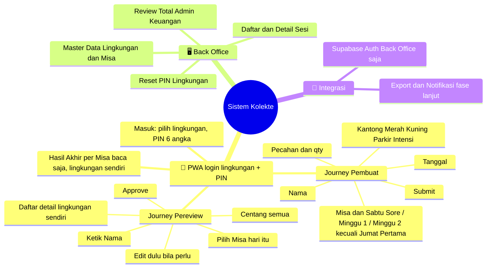

---

## 4. 🔄 General Flow Process

### 4.1 Journey Pembuat (PWA)

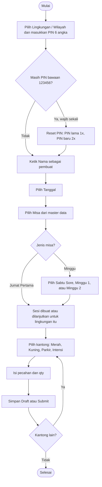

### 4.2 Journey Pereview (PWA)

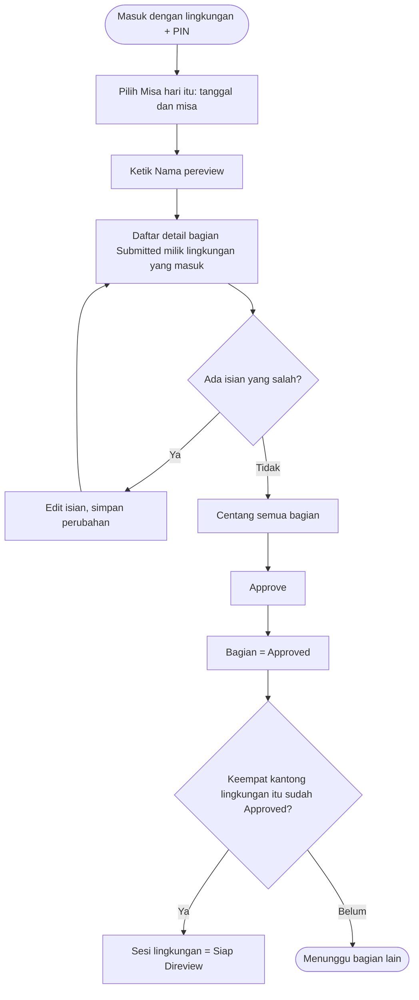

### 4.3 Review Total (Back Office)

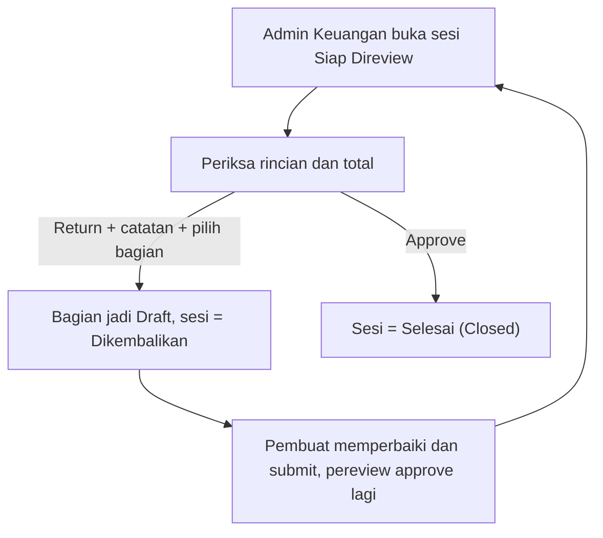

**Aturan kunci**
1. Setiap bagian wajib diisi minimal satu baris qty > 0, atau ditandai "Kosong", sebelum Submit.
2. Sesi **Siap Direview** hanya jika keempat bagian (Merah, Kuning, Parkir, Intensi) sudah **Approved**. Parkir dan Intensi wajib; bila nilainya 0, submit dengan tanda "Kosong".
3. Pembuat dan pereview boleh orang yang sama; nama keduanya tetap wajib diketik dan dicatat.
4. Approve bersifat sekaligus: semua bagian yang dicentang disetujui bersama, atau tidak sama sekali.
5. Tombol Approve baru aktif setelah semua bagian yang dapat disetujui pereview dicentang.

---

## 5. 🔁 State Machine

### 5.1 Status Bagian

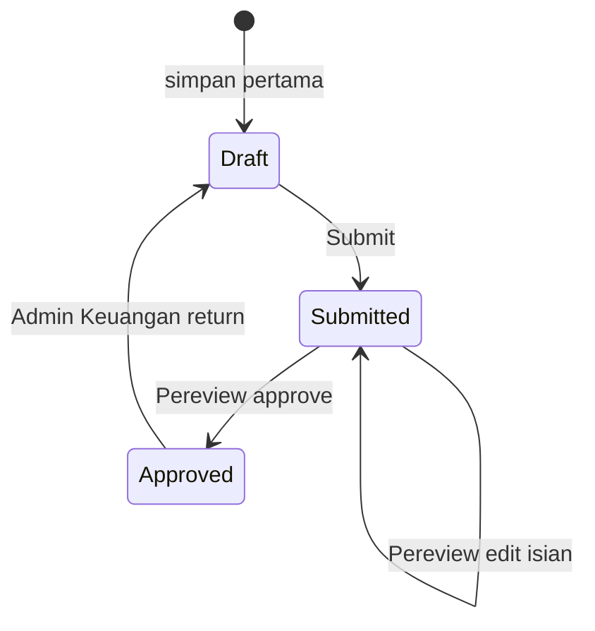

### 5.2 Status Sesi

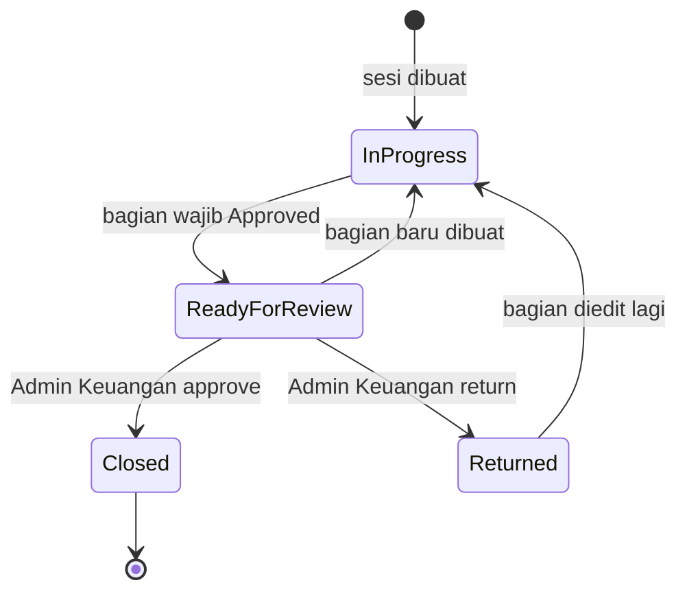

---

## 6. 📝 Business Requirements

### 6.1 Functional Requirements — PWA

| ID | Requirement | Prioritas |
|---|---|---|
| FR-PWA-01 | **Nama** diketik manual (wajib, 2–60 karakter), diingat di perangkat. Nama pembuat tersimpan per bagian; nama pereview tersimpan per tindakan review. | High |
| FR-PWA-02 | Urutan isian pembuat (setelah masuk): **Nama → Tanggal → Misa (master data) → Sabtu Sore / Minggu 1 / Minggu 2 (wajib untuk misa berjenis Minggu, tidak ditampilkan untuk Jumat Pertama)**. Lingkungan otomatis lingkungan yang masuk. | High |
| FR-PWA-03 | Satu lingkungan hanya punya satu sesi per kombinasi tanggal + misa; membuka lagi = melanjutkan sesi yang ada. | High |
| FR-PWA-04 | Halaman sesi menampilkan kartu Kantong Merah, Kuning, Parkir, Intensi beserta status dan subtotal. Keempatnya wajib. | High |
| FR-PWA-05 | Setiap kantong diisi langsung per **pecahan × qty** (11 pecahan tetap); subtotal dan total dihitung otomatis. Tidak ada kategori. | High |
| FR-PWA-06 | Parkir dan Intensi diisi dengan pola yang sama dan **wajib**; nilai 0 dicatat dengan tanda "Kosong". | High |
| FR-PWA-07 | Validasi: qty bilangan bulat 0–1.000.000, pecahan salah satu dari 11 pecahan tetap, tidak ada baris ganda. Bagian tidak bisa disubmit kosong kecuali ditandai "Kosong". | High |
| FR-PWA-08 | Submit mengunci isian pembuat (status Submitted). | High |
| FR-PWA-09 | **Review per misa:** pereview memilih tanggal + misa, mengetik namanya, lalu melihat daftar detail semua bagian Submitted milik lingkungan yang masuk, untuk semua kategori pada misa itu. | High |
| FR-PWA-10 | Setiap bagian punya kotak centang. **Approve** baru aktif setelah semua bagian dalam daftar dicentang (tersedia tombol "Centang semua"). | High |
| FR-PWA-11 | Pereview dapat **Edit dulu** (ubah pecahan/qty) pada bagian Submitted, lalu kembali ke daftar dan approve. Edit dicatat (nama pereview, subtotal sebelum → sesudah). | High |
| FR-PWA-12 | Approve memproses semua bagian yang dicentang secara atomik. Pereview boleh sama dengan pembuat. | High |
| FR-PWA-13 | Sesi otomatis **Siap Direview** saat keempat bagian Approved (Aturan kunci #2). | High |
| FR-PWA-14 | Draft tersimpan lokal (offline) dan tersinkron saat online. **Belum dibangun.** | Medium |
| FR-PWA-16 | **Hasil akhir per misa (baca saja), hanya lingkungan yang masuk:** pilih tanggal + misa, lihat total tiap kantong, total lingkungan, status sesi (hanya kategori Sabtu Sore/Minggu 1/Minggu 2 yang dibuat lingkungan itu; kategori yang tidak dibuat tidak ditampilkan), dan **rekap per pecahan yang dipisah per kantong (Merah, Kuning, Parkir, Intensi), tidak digabung**. Tidak bisa menutup/finalisasi; finalisasi tetap oleh Admin Keuangan di Back Office. | High |
| FR-PWA-15 | Dapat di-install ke home screen (manifest; service worker belum). | Medium |
| FR-PWA-17 | **Masuk PWA:** pilih lingkungan/wilayah (master data aktif) lalu masukkan PIN 6 angka. PIN awal semua lingkungan 123456. Salah → pesan error; 5 kali salah berturut-turut mengunci lingkungan itu 15 menit. | High |
| FR-PWA-18 | **Reset PIN (wajib sekali):** selama PIN masih bawaan, semua halaman dan aksi diarahkan ke halaman Reset PIN sampai selesai. Isian: **PIN lama 1×, PIN baru 2× (diulang)**; PIN baru 6 angka, harus sama dengan pengulangan, dan bukan 123456. Setelah berhasil, tombol menjadi "Ganti PIN". | High |
| FR-PWA-19 | **Ganti PIN:** formulir yang sama (PIN lama 1×, PIN baru 2×). Setelah diganti, perangkat lain yang sedang masuk keluar otomatis. | Medium |
| FR-PWA-20 | **Isolasi lingkungan:** semua halaman dan aksi PWA (isian, review, hasil) hanya menyentuh data lingkungan yang masuk; server menolak data lingkungan lain. | High |

### 6.2 Functional Requirements — Back Office

| ID | Requirement | Prioritas |
|---|---|---|
| FR-BO-01 | Login (hanya Back Office): Admin dan Admin Keuangan; RBAC. | High |
| FR-BO-02 | Daftar sesi (tanggal, lingkungan, misa+bulan, status, total); antrean Siap Direview di atas. | High |
| FR-BO-03 | Detail sesi: rincian tiap bagian per pecahan, subtotal, **total keseluruhan**, rekap per pecahan **per kantong** (tidak digabung), nama pembuat/pereview, dan tanda "Diedit oleh …" bila pereview mengubah isian (satu-satunya tempat edit pereview terlihat; pembuat tidak diberi notifikasi). | High |
| FR-BO-04 | Admin Keuangan **Approve** (sesi Closed) atau **Return** dengan catatan dan memilih bagian yang dibuka ulang. Admin biasa hanya melihat. | High |
| FR-BO-05 | Review total tidak mengubah angka; hanya approve atau return. | High |
| FR-BO-06 | **Master data Lingkungan dan Misa (CRUD)** oleh Admin dan Admin Keuangan: tambah, ubah (Lingkungan: nama, urutan; Misa: nama, **jenis Minggu atau Jumat Pertama**; tanpa urutan, yang terbaru di atas), aktif/nonaktif, dan hapus hanya bila belum dipakai. Sabtu Sore/Minggu 1/Minggu 2, pecahan, dan jenis kantong bukan master data. | High |
| FR-BO-13 | **Daftar dengan pencarian dan filter:** Sesi Kolekte (cari teks; filter status, lingkungan, misa, rentang tanggal), Master Lingkungan dan Misa (cari nama; filter status, dan jenis untuk Misa), dan PIN Lingkungan (cari nama; filter status PIN). Filter berupa parameter alamat sehingga bisa dibagikan/dimuat ulang. | Medium |
| FR-BO-14 | **Tambah dan Ubah di halaman tersendiri** untuk master data (`/admin/master/{key}/baru` dan `/admin/master/{key}/{id}`); daftar hanya menampilkan data dengan aksi Ubah, Nonaktifkan/Aktifkan, dan Hapus (dengan konfirmasi). Setelah aksi, daftar kembali dengan pencarian dan filter yang sama. | Medium |
| FR-UI-03 | **Menu bawah di PWA** (seperti aplikasi seluler) dengan empat tab: **Review**, **Hasil**, **Ganti PIN**, **Keluar**; tab yang sedang dibuka disorot. Selama PIN masih bawaan hanya **Reset PIN** dan **Keluar** yang tampil. Tidak tampil di halaman masuk dan Back Office. Logo/judul di header membawa kembali ke beranda (Isi Kolekte). | Medium |
| FR-UI-02 | **Notifikasi (toast) di Back Office dan PWA** setiap ada perubahan yang berhasil (masuk/keluar, simpan draft, submit, approve, edit, ganti/reset PIN, tambah/ubah/hapus/aktifkan master, tutup/kembalikan sesi). Pop-up kanan bawah, hilang otomatis dalam beberapa detik dan bisa ditutup. Pesan galat tetap tampil di dalam halaman. Belum ada pusat notifikasi antar pengguna. | Medium |
| FR-BO-12 | **Navigasi Back Office hanya lewat sidebar** (Sesi Kolekte, Lingkungan / Wilayah, Misa, PIN Lingkungan, Keluar); halaman tidak memiliki tombol navigasi lain. Di layar kecil sidebar menjadi bilah atas. | Medium |
| FR-UI-01 | **Identitas visual:** logo Paroki Santo Yohanes Gabriel Perboyre di header PWA, halaman masuk, login Back Office, sidebar, dan ikon aplikasi; warna hijau (header dan sidebar hijau tua, tombol hijau). | Medium |
| FR-BO-11 | **Reset PIN lingkungan** oleh Admin / Admin Keuangan: PIN kembali ke **123456**, wajib diganti lagi saat masuk berikutnya, dan semua perangkat lingkungan itu keluar. Admin tidak melihat atau menentukan PIN yang dipilih lingkungan. Halaman menampilkan status tiap lingkungan (PIN bawaan, sudah diganti, terkunci). | High |
| FR-BO-07 | Laporan rekap dan export Excel/PDF. **Belum dibangun.** | Medium |
| FR-BO-08 | Audit log umum. **Belum dibangun**; saat ini jejak review tersimpan di `section_review` (APPROVE, EDIT) dan `session_review` (APPROVE, RETURN). | Medium |
| FR-BO-09 | Sesi Closed read-only. | High |
| FR-BO-10 | Layar kelola pengguna Back Office. **Belum dibangun**; dibuat lewat Supabase Auth dan tabel `bo_user`. | Low |

### 6.3 Non-Functional Requirements

| ID | Kategori | Requirement |
|---|---|---|
| NFR-01 | Performa | Respons halaman input < 2 detik pada 4G; subtotal dihitung instan di klien. |
| NFR-02 | Ketersediaan | 99,5% pada jam misa. |
| NFR-03 | Keamanan | HTTPS, RBAC, validasi server-side, tabel hanya diakses lewat server (service role), fungsi database tidak dapat dipanggil dari browser. |
| NFR-04 | Integritas data | Uang disimpan integer (rupiah); total dihitung ulang server; nilai pecahan disimpan sebagai snapshot di baris. |
| NFR-05 | Auditability | Perubahan status dan edit pereview tercatat; riwayat review tidak dapat dihapus lewat aplikasi. |
| NFR-06 | Usability | Mobile-first, input numerik, bahasa Indonesia. |
| NFR-07 | Offline | Draft bertahan saat koneksi putus (**rencana**). |
| NFR-08 | Kompatibilitas | Android Chrome dan iOS Safari terbaru. |

---

## 7. 👥 Use Case

| ID | Use Case | Aktor | Deskripsi | Prioritas |
|---|---|---|---|---|
| UC-01 | Login Back Office | Admin, Admin Keuangan | Autentikasi | High |
| UC-02 | Mulai Sesi | Pembuat | Nama, tanggal, misa (+bulan), lingkungan | High |
| UC-03 | Isi dan Submit Bagian | Pembuat | Pilih kantong, isi pecahan × qty, submit | High |
| UC-04 | Review Misa | Pereview | Pilih misa hari itu, ketik nama, lihat daftar, centang semua, approve | High |
| UC-05 | Edit Sebelum Approve | Pereview | Ubah isian bagian Submitted | High |
| UC-06 | Review Total Sesi | Admin Keuangan | Approve (Closed) atau Return | High |
| UC-08 | Lihat Hasil Akhir | Siapa pun di PWA | Rekap per misa (baca saja) | High |
| UC-07 | Kelola Master Data | Admin, Admin Keuangan | CRUD Lingkungan dan Misa | High |
| UC-09 | Masuk PWA | Pembuat, Pereview | Pilih lingkungan + PIN 6 angka; Reset PIN wajib sekali dari PIN bawaan, lalu Ganti PIN | High |
| UC-10 | Reset PIN Lingkungan | Admin, Admin Keuangan | Kembalikan PIN ke 123456 agar lingkungan menggantinya lagi | High |

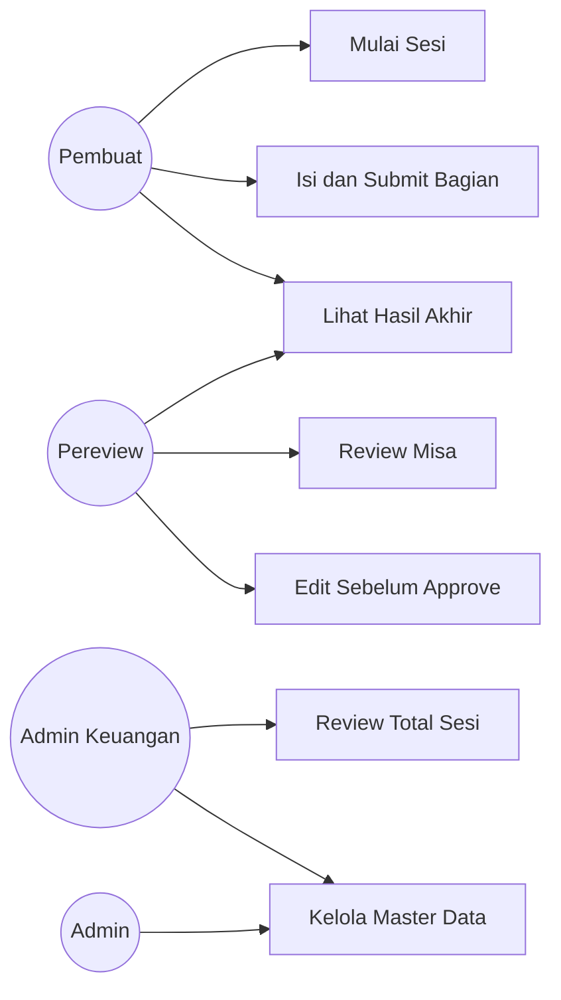

---

## 8. 🔀 Sequence Diagram

### 8.1 Pembuat: Submit Bagian

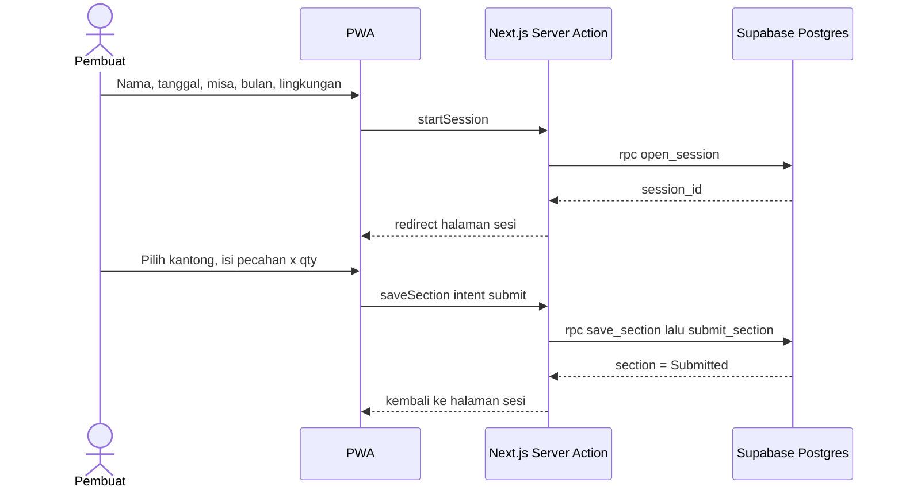

### 8.2 Pereview: Edit lalu Approve

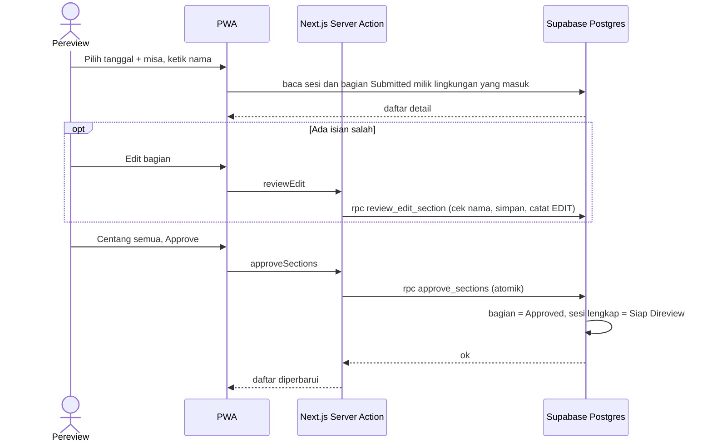

### 8.3 Review Total

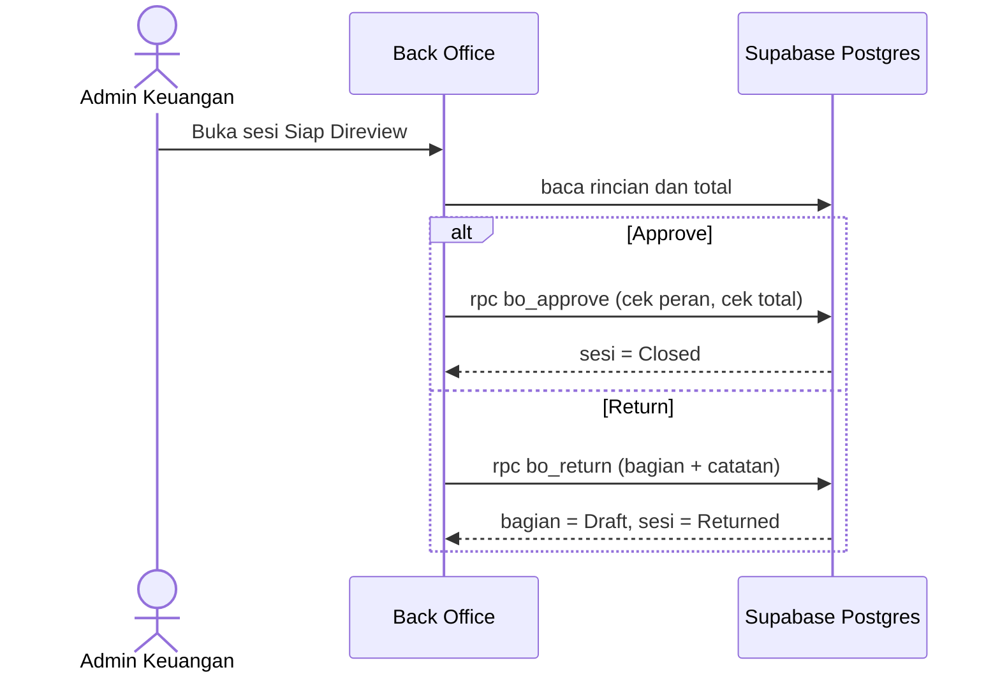

---

## 9. 🗄️ ERD / Data Model

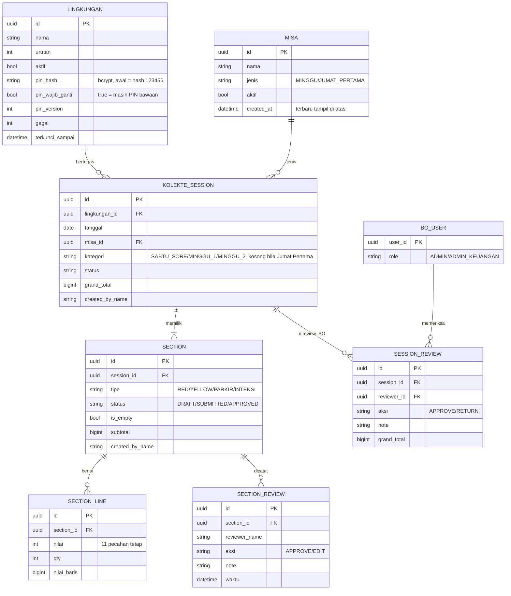

**Catatan data**
- Unik: `(lingkungan_id, tanggal, misa_id, kategori)` pada sesi (kategori kosong dianggap satu nilai); `(session_id, tipe)` pada bagian; `(section_id, nilai)` pada baris.
- `nilai` dibatasi ke 11 pecahan tetap lewat constraint database (fungsi `valid_nilai`). Lingkungan berasal dari master `lingkungan` (bukan konstanta).
- `nilai_baris = nilai × qty` disimpan di baris sehingga rekap tidak perlu menghitung ulang.
- `kategori` wajib untuk misa berjenis MINGGU dan kosong untuk JUMAT_PERTAMA (dijaga fungsi `open_session`; nilainya dibatasi constraint database).

---

## 10. 🧩 Component Architecture

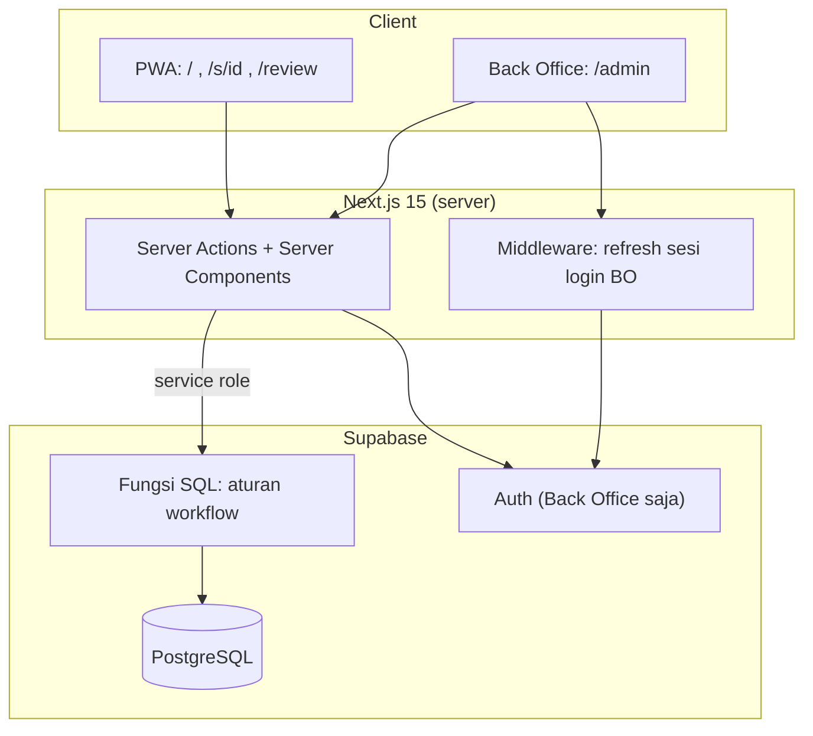

---

## 11. 🔌 Integration Map

| Kategori | Kebutuhan | Rekomendasi | Fase |
|---|---|---|---|
| Auth | Back Office: Supabase Auth (email + password). PWA: lingkungan + PIN 6 angka (hash bcrypt di database, sesi cookie bertanda tangan, 14 hari) | Supabase Auth + fungsi SQL | 1 (selesai) |
| Export | Rekap Excel/PDF | Library server-side | 2 |
| Notifikasi | Ingatkan Admin Keuangan saat Siap Direview | Email / WhatsApp | 2 |
| Monitoring | Error tracking | Sentry | 2 |
| ERP/Payment | Tidak diperlukan | — | Out of scope |

---

## 12. 🏗️ Technical Stack

| Layer | Pilihan |
|---|---|
| Frontend + server | Next.js 15 (App Router, Server Actions), React 19, TypeScript |
| Database + Auth | Supabase (PostgreSQL, Auth). Aturan workflow di fungsi SQL (atomik), akses tabel hanya via service role |
| Hosting | Vercel + Supabase |

### 12.1 Permukaan Aplikasi

| Alamat | Fungsi |
|---|---|
| `/masuk` | Masuk PWA: pilih lingkungan + PIN 6 angka |
| `/pin` | Reset PIN (wajib sekali dari PIN bawaan), lalu Ganti PIN: PIN lama 1×, PIN baru 2× |
| `/` | Journey pembuat: mulai sesi (lingkungan dari login) |
| `/s/{id}`, `/s/{id}/{tipe}` | Kartu kantong dan formulir pecahan |
| `/review` | Journey pereview: pilih misa, nama, daftar, centang, approve |
| `/review/edit/{sectionId}` | Pereview mengedit bagian |
| `/hasil` | Hasil akhir per misa, hanya lingkungan yang masuk (baca saja) |
| `/admin`, `/admin/{id}` | Daftar dan detail sesi, review total |
| `/admin/master/lingkungan`, `/admin/master/misa` | Master data Lingkungan dan Misa (CRUD) |
| `/admin/pin` | Reset PIN lingkungan |

### 12.2 Hak Akses

| Fitur | Pembuat (PWA) | Pereview (PWA) | Admin | Admin Keuangan |
|---|---|---|---|---|
| Isi dan submit bagian | ✅ | — | ❌ | ❌ |
| Review misa (centang, edit, approve) | ❌ | ✅ | ❌ | ❌ |
| Review total (approve/return sesi) | ❌ | ❌ | ❌ | ✅ |
| Master data Lingkungan dan Misa (CRUD) | ❌ | ❌ | ✅ | ✅ |
| Reset PIN lingkungan | ❌ | ❌ | ✅ | ✅ |
| Ganti PIN sendiri | ✅ | ✅ | — | — |
| Lihat hasil akhir per misa (`/hasil`, hanya lingkungan sendiri) | ✅ | ✅ | ❌ | ❌ |
| Lihat daftar dan detail sesi (`/admin`) | ❌ | ❌ | ✅ | ✅ |

Pembuat dan pereview adalah peran per tindakan, bukan akun. Orang yang sama boleh menjadi pembuat sekaligus pereview, bahkan pada bagian yang sama.

**Catatan risiko (PWA):** nama pembuat/pereview tetap diketik bebas, dan karena pembuat boleh sama dengan pereview tidak ada pemisahan tugas di PWA. Akses PWA dibatasi PIN 6 angka per lingkungan (hash, penguncian setelah 5 kali salah, sesi batal bila PIN berubah). PIN 6 angka relatif mudah ditebak, dan **PIN bawaan 123456 diketahui umum**, sehingga lingkungan yang belum melakukan Reset PIN rentan sampai itu dilakukan; Admin dapat mereset kapan saja. Pengendali kompensasinya ada di Admin Keuangan yang melihat nama dan rincian per pecahan lintas lingkungan.

---

## 13. ❓ Open Questions

| # | Pertanyaan | Dampak |
|---|---|---|
| Q4 | Intensi hanya uang, atau juga nama/tujuan intensi dari Romo? | Field tambahan |
| Q5 | Berapa lama setelah Closed koreksi masih boleh, dan siapa yang boleh? | Aturan koreksi |
| Q12 | Dua misa berbeda di hari yang sama (mis. Minggu 1 dan 2) dipisah per misa dan direview per misa. Sudah sesuai? | Konfirmasi |

**Sudah diputuskan:**
- Pecahan (11) dan jenis kantong adalah konstanta, bukan master data. Kategori kantong dihapus.
- Master Misa berisi nama misa/perayaan dengan **jenis** Minggu atau Jumat Pertama. Sabtu Sore/Minggu 1/Minggu 2 adalah pilihan tetap, bukan master. Jumat Pertama = satu baris master per bulan.
- Master data: **Lingkungan/Wilayah** (CRUD; awal 7 lingkungan + OMK + WKRI) dan **Misa**, dikelola Admin dan Admin Keuangan.
- Parkir dan Intensi **wajib**, meski nilainya 0 (ditandai "Kosong").
- PWA **masuk dengan lingkungan + PIN 6 angka**. PIN awal semua lingkungan **123456** dan **wajib di-Reset sekali** saat pertama masuk; sesudahnya tombol menjadi **Ganti PIN**. Isian sama: PIN lama 1×, PIN baru 2× (diulang). Admin/Admin Keuangan dapat mereset PIN lingkungan (kembali ke 123456, wajib diganti lagi); Admin tidak melihat atau menentukan PIN. 5 kali salah mengunci 15 menit.
- Pembuat **tidak diberi notifikasi** bila bagiannya diedit pereview; hanya terlihat di Back Office.
- Pembuat dan pereview boleh orang yang sama.
- PWA dapat melihat hasil akhir per misa (baca saja); finalisasi tetap Admin Keuangan.
- Tiap petugas memilih satu kantong; ada 4 isian per misa per lingkungan.
- Field Perayaan dan tombol Tolak dihapus; review per misa dengan checklist. Isian, review, dan hasil di PWA **hanya untuk lingkungan yang masuk**; lintas lingkungan hanya di Back Office.

---

## 14. ✅ Acceptance Criteria Ringkas

1. Pembuat memilih lingkungan lalu memasukkan PIN 6 angka; setelah masuk mengisi: Nama → Tanggal → Misa → (Sabtu Sore/Minggu 1/Minggu 2 untuk misa Minggu); kombinasi lingkungan + tanggal + misa + kategori tidak ganda.
2. Memilih misa berjenis Minggu menampilkan pilihan Sabtu Sore/Minggu 1/Minggu 2 (wajib); memilih misa berjenis Jumat Pertama tidak menampilkannya. Saat menambah misa di master, Admin wajib memilih jenis Minggu atau Jumat Pertama.
3. Setiap kantong diisi langsung per pecahan (11 pecahan); satu baris tiap pecahan dengan qty 1 menghasilkan Rp263.800.
4. Bagian tidak bisa disubmit kosong tanpa centang "Kosong". Parkir dan Intensi wajib di-submit (boleh "Kosong").
5. Pereview memilih misa hari itu, mengetik nama, dan melihat bagian Submitted **milik lingkungan yang masuk**, termasuk daftar bagian yang belum diisi.
6. Approve tidak aktif sebelum semua bagian yang dapat disetujui dicentang; approve memproses semuanya sekaligus (atomik).
7. Pembuat dan pereview boleh orang yang sama; kedua nama tetap wajib diisi dan tercatat.
8. Pereview dapat mengedit bagian Submitted lalu approve; edit tercatat dan terlihat di Back Office.
9. Sesi menjadi Siap Direview hanya setelah keempat bagian Approved.
10. Admin Keuangan melihat total gabungan dan rincian per pecahan di tiap kantong (tidak digabung), dapat Approve atau Return; Admin biasa tidak bisa.
11. Sesi Closed tidak dapat diubah.
12. Admin dan Admin Keuangan dapat menambah/mengubah/menonaktifkan/menghapus (bila belum dipakai) Lingkungan dan Misa lewat web tanpa ubah kode; OMK dan WKRI ada sebagai data awal.
13. Di PWA, memilih tanggal + misa menampilkan hasil **hanya lingkungan yang masuk**: total tiap kantong dan lingkungan, status, serta rekap per pecahan yang dipisah per kantong (Merah, Kuning, Parkir, Intensi); halaman ini tidak punya aksi ubah.
14. Semua lingkungan awalnya ber-PIN 123456; saat pertama masuk, lingkungan diarahkan ke Reset PIN dan tidak bisa memakai halaman lain sebelum PIN diganti. Reset PIN meminta PIN lama 1× dan PIN baru 2×; pengulangan berbeda atau PIN baru 123456 ditolak.
15. Lima kali salah PIN berturut-turut mengunci lingkungan itu 15 menit.
16. Admin/Admin Keuangan dapat mereset PIN lingkungan ke 123456; setelah itu semua perangkat lingkungan itu keluar dan wajib Reset PIN lagi saat masuk. Setelah Reset PIN pertama, tombolnya menjadi Ganti PIN.
17. Pengguna lingkungan A tidak dapat melihat, mengisi, mereview, atau menyetujui data lingkungan B lewat PWA.

---

## 15. 🛣️ Status Implementasi

| Bagian | Status |
|---|---|
| Skema, fungsi workflow, seed Misa dan Lingkungan | ✅ `supabase/migrations/001_init.sql`, `002_jumat_pertama_pilihan.sql`, `003_lingkungan_master_pin.sql` |
| PWA journey pembuat | ✅ |
| PWA journey pereview (checklist, edit, approve) | ✅ |
| PWA hasil akhir per misa (baca saja) | ✅ |
| PWA masuk dengan lingkungan + PIN (PIN bawaan 123456, Reset PIN wajib sekali, Ganti PIN) | ✅ |
| Back Office: daftar, detail, review total | ✅ |
| Back Office: master data Lingkungan dan Misa (CRUD), reset PIN | ✅ |
| Draft offline / service worker | ⏳ belum |
| Laporan dan export | ⏳ belum |
| Audit log umum, layar pengguna BO | ⏳ belum |
| Notifikasi | ⏳ tidak direncanakan (pembuat tidak diberi tahu bila bagiannya diedit pereview) |
| Uji dengan Supabase sungguhan (UAT) | ⏳ belum |

## 16. ➡️ Rekomendasi Langkah Selanjutnya

1. Jalankan `001_init.sql`, `002_jumat_pertama_pilihan.sql`, lalu `003_lingkungan_master_pin.sql` di Supabase (berurutan, masing-masing sekali), buat user Back Office, dan uji kedua journey end-to-end (kode belum pernah dijalankan terhadap database sungguhan).
2. Putuskan Q4 (detail Intensi) dan Q5 (koreksi setelah Closed).
3. Lanjut ke draft offline, lalu laporan/export.
